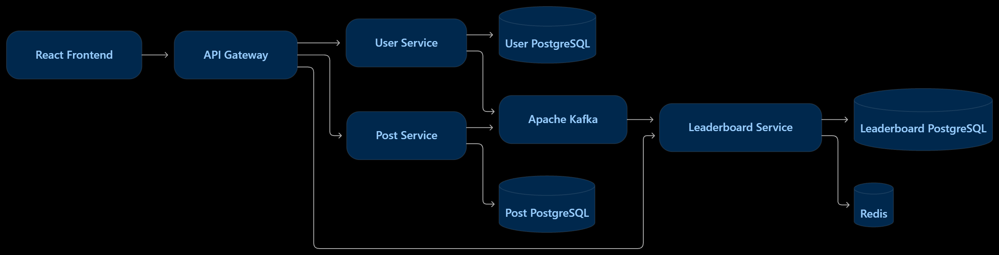
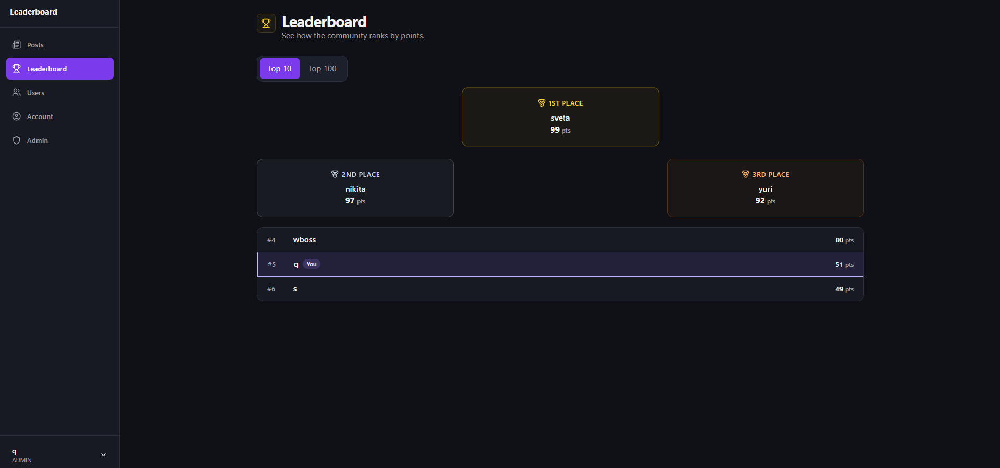
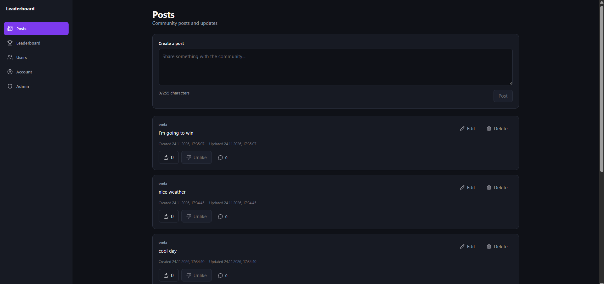
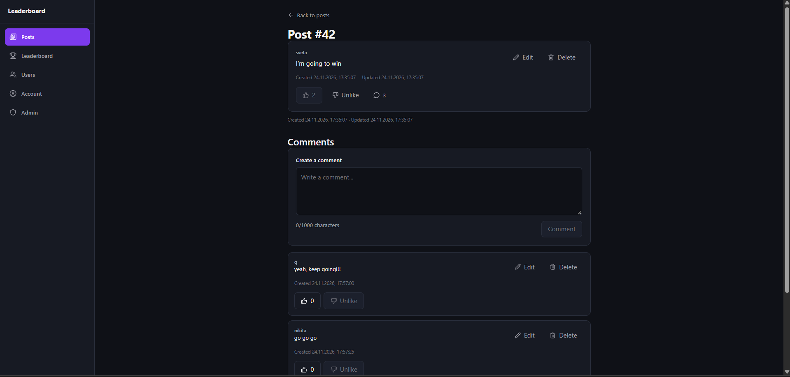
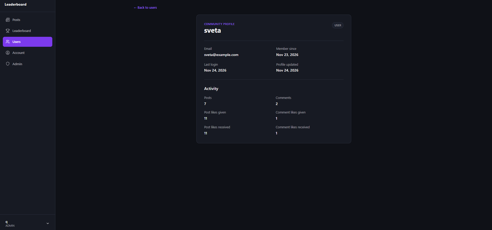

# Leaderboard Project


A full-stack community platform where users publish posts, discuss them in comments, like content, and earn points on a live leaderboard.

Built with **Java, Spring Boot, React, and TypeScript**, the backend is structured as independent microservices communicating asynchronously via **Apache Kafka**, with **PostgreSQL** for durable storage and **Redis** for fast leaderboard reads.
## Demo
https://github.com/user-attachments/assets/7cb2eaf5-a3ad-4b4e-9fd7-3adc2fb5f4a1

## Features

- **Accounts & Security:** User registration, login by username or email, RSA-signed JWT access tokens, rotating refresh tokens, and logout.
- **Community Content:** Paginated public feed, post and comment creation, and owner/admin editing and deletion.
- **Engagement & Scoring:** Likes on posts and comments with anti-gaming scoring rules — posts award 10 points, comments award 2 points to both author and commenter, and likes award 1 point each. Self-likes and self-comments are saved but do not earn points, and scores never drop below zero.
- **User Profiles:** User directory, editable profiles, password management, and live activity statistics (posts, comments, and likes given/received).
- **Leaderboards:** Public Top 10 and Top 100 rankings with a podium view, current-user highlighting, and automatic background refresh.
- **Admin Panel:** Role-protected routes to create users, update profiles, change roles, reset passwords, and delete accounts.
- **Responsive UI:** Desktop and mobile layouts with accessible dialogs, validation feedback, and explicit loading, empty, and error states.

## Technology Stack

| Area | Technologies |
| --- | --- |
| Backend | Java 25, Spring Boot 4.1.1, Spring MVC, Spring Security (OAuth2 / JWT), Spring Data JPA, MapStruct, Liquibase, OpenAPI / Swagger |
| Microservices & Messaging | Spring Cloud Gateway (Web MVC), Apache Kafka, Spring Kafka, Spring Data Redis |
| Frontend | React 19, TypeScript 7, Vite, Tailwind CSS, React Router, Axios |
| Databases | PostgreSQL 16 (database-per-service), Redis 7 |
| Infrastructure | Docker, Docker Compose, Maven, npm, Kafka UI |
| Backend Testing | JUnit 6, Mockito, AssertJ, MockMvc, Testcontainers, Awaitility, JaCoCo |
| Frontend Testing | Vitest, React Testing Library |

## Architecture


### Modules

- **API Gateway (`api-gateway`)** – Single HTTP entry point for the frontend. Handles routing, CORS, JWT verification, and trusted identity header forwarding.
- **User Service (`user-service`)** – Manages accounts, BCrypt password hashing, JWT issuance, refresh-token rotation, profiles, and admin operations.
- **Post Service (`post-service`)** – Manages posts, comments, likes, permissions, and profile activity counts.
- **Leaderboard Service (`leaderboard-service`)** – Consumes activity events, calculates scores, stores durable ranking state, syncs Redis, and serves Top 10 / Top 100 queries.
- **Leaderboard Contract (`leaderboard-contract`)** – Shared Java records and enums for Kafka event contracts (build-time library, not a running service).

### Key Engineering Highlights

- **Reliable Event Delivery (Transactional Outbox):** User and Post services save domain changes and outbox events in the same database transaction. Background workers publish pending events to Kafka with retries, preventing lost messages if the broker is temporarily unavailable.
- **Idempotent Processing & Error Handling:** Leaderboard Service records processed event IDs in PostgreSQL to prevent duplicate scoring on redelivery. Failed consumer messages use configured retries and Dead Letter Topics (`-dlt`).
- **Durable State + Fast Redis Reads:** PostgreSQL acts as the source of truth for scores and deduplication, while Redis Sorted Sets serve fast Top 10 / Top 100 lookups. A dedicated sync worker keeps Redis updated, and the leaderboard automatically rebuilds from PostgreSQL on startup.
- **Gateway-Level Auth Boundary:** User Service signs RS256 access tokens with a private key and stores refresh tokens as SHA-256 hashes. API Gateway validates tokens with the public key, strips any client-supplied `X-User-Id` / `X-User-Role` headers, and forwards trusted identity headers to private downstream services.
- **Strict Service Isolation:** Each domain service owns its own PostgreSQL database and credentials, with no shared tables and no direct service-to-service HTTP calls.

## Getting Started

### Prerequisites

- **Docker** with **Docker Compose**
- **Java 25** and **Maven 3.9+** (for local builds and tests)
- **Node.js 24.15+ (24.x)** or **26+** with **npm**
- **OpenSSL** (for generating local JWT keys)

> Commands below use Bash (Linux, macOS, or Git Bash on Windows).

### 1. Generate local JWT keys

The backend requires an RSA key pair for signing and validating JWTs. From the repository root, run:

```bash
mkdir -p secrets
openssl genpkey -algorithm RSA -pkeyopt rsa_keygen_bits:2048 -out secrets/user-service-private.pem
openssl pkey -in secrets/user-service-private.pem -pubout -out secrets/user-service-public.pem
```

The `secrets/` directory is gitignored; never commit the private key.

### 2. Start the backend and infrastructure

The project uses two Compose files: one for infrastructure (PostgreSQL, Kafka, Redis) and an overlay for the backend services and Kafka UI.

```bash
GATEWAY_CORS_ALLOWED_ORIGINS="http://localhost:5173" \
  docker compose -f docker-compose.yml -f docker-compose.app.yml up --build -d
```

To start only the infrastructure (when running Spring Boot services directly on your host):

```bash
docker compose -f docker-compose.yml up -d
```

### 3. Start the frontend

In a new terminal, from the repository root:

```bash
cd frontend
npm ci
VITE_API_BASE_URL="http://localhost:8081" npm run dev -- --port 5173 --strictPort
```

Open **[http://localhost:5173](http://localhost:5173)** in your browser.

### Local URLs

| Component | URL / Port | Notes |
| --- | --- | --- |
| Frontend | `http://localhost:5173` | Vite dev server |
| API Gateway | `http://localhost:8081` | Main API entry point |
| Kafka UI | `http://localhost:18081` | Available with Compose app overlay |
| Post Service | `http://localhost:8080` | Direct port when run on host |
| Leaderboard Service | `http://localhost:8082` | Direct port when run on host |
| User Service | `http://localhost:8084` | Direct port when run on host |

## Testing & Code Coverage

### Backend

The backend suite combines unit tests (Mockito), controller tests (MockMvc), real HTTP Gateway tests, and **Testcontainers** integration tests backed by real PostgreSQL, Kafka, and Redis containers (including retry and dead-letter topic flows).

Run the full backend verification from the repository root:

```bash
mvn clean verify
```

JaCoCo generates per-service coverage reports at `<service>/target/site/jacoco/index.html`:

| Service | Instruction Coverage | Branch Coverage |
| --- | ---: | ---: |
| API Gateway | 95% | 85% |
| User Service | 96% | 87% |
| Leaderboard Service | 85% | 85% |
| Post Service | 96% | 66% |

### Frontend

From the `frontend` directory:

```bash
npm test         # Vitest + React Testing Library
npm run lint     # TypeScript type check
npm run build    # Production build
```

## Project Structure

```text
leaderboard-project/
├── api-gateway/              # Routing, JWT verification, CORS, identity headers
├── user-service/             # Accounts, auth, profiles, Liquibase migrations
├── post-service/             # Posts, comments, likes, activity, Kafka outbox
├── leaderboard-service/      # Event consumers, scoring, PostgreSQL & Redis sync
├── leaderboard-contract/     # Shared Kafka event records and enums
├── frontend/                 # React + TypeScript SPA and Vitest suite
├── docker-compose.yml        # PostgreSQL, Kafka, and Redis
└── docker-compose.app.yml    # Backend containers and Kafka UI overlay
```

## API Overview

All frontend requests are routed through the API Gateway at `http://localhost:8081`:

| Service | Main API Paths |
| --- | --- |
| User Service | `/api/auth/*`, `/api/users/*`, `/api/admin/users/*` |
| Post Service | `/api/posts/*` (posts, comments, likes, engagement, user activity) |
| Leaderboard Service | `/api/leaderboard/top-10`, `/api/leaderboard/top-100` |

Interactive **OpenAPI / Swagger UI** documentation is available at `/swagger-ui.html` on each domain service's local port when running the services directly on the host.

## Screenshots

### Leaderboard (Top 10 & Top 100)


### Posts


### Post & Comments


### User Profile & Activity Stats
